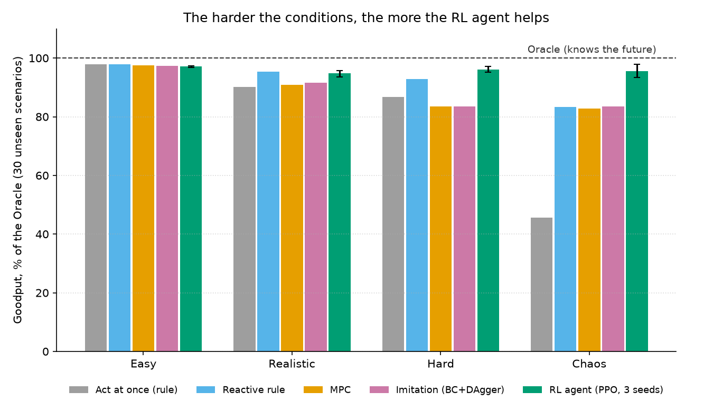

# Self-healing training on mixed GPUs: simulator + RL agent

A Mac (Apple M2) and two Windows laptops (NVIDIA) fine-tune one model together.
Machines crash, slow down, lose network bandwidth, and come back. An agent watches
the cluster and picks a fix (WAIT, REBALANCE, COMPENSATE, EVICT, READMIT) to keep
**goodput** (useful training per hour) high. This repo is the simulator, the
agents, and the experiments. Real-hardware runs come later.

**Hypothesis:** a learned (RL) agent makes faster and better recovery decisions
than hand-written rules, especially when conditions are messy.



## Results (30 unseen scenarios per level, RL = 3 independent training runs)

Goodput as % of the Oracle (an upper bound that knows the future):

| Level | Simple rule (best) | MPC | Imitation (BC+DAgger) | **RL (PPO)** | RL − rule, 95% CI |
|---|---|---|---|---|---|
| Easy | 97.9 | 97.5 | 97.4 | 97.1 | −0.8 [−1.0, −0.6] |
| Realistic | 95.3 | 90.9 | 91.7 | 94.7 | −0.5 [−2.0, +1.2] (tie) |
| Hard | 92.9 | 83.5 | 83.5 | **96.1** | **+3.3 [+1.5, +5.3]** |
| Chaos | 83.3 | 82.8 | 83.5 | **95.5** | **+12.2 [+8.6, +16.2]** |

- RL decides in **0.17 ms** per step.
- In calm conditions, a simple rule is as good as RL. The harder and noisier it
  gets, the more RL wins. In chaos, the old baselines collapse to ~46% (worst
  episode 6%); RL's worst episode is 72%.
- Full tables: `results/report.txt` (v2) and `results/report_v1_3seeds.txt` (the
  first RL version, kept for honesty: one lucky seed looked great, three seeds did not).

## What makes the simulator hard (`scenarios.py`)

| Level | What happens |
|---|---|
| easy | the original mix: 1 permanent crash, 2-3 slowdowns, exact measurements |
| realistic | 5% measurement noise, false-alarm spikes, all-reduce time over Wi-Fi, the 8 GB Mac capped at 30% of a batch, crashes that often come back, slowdowns with unknown (heavy-tailed) durations, gradual thermal ramps, network slowdowns, flapping machines |
| hard | more of everything, overlapping faults, a Wi-Fi-wide slowdown, 10% noise |
| chaos | fault storms, simultaneous crashes, 15% noise |

## Breaking it (`stress_test.py`)

- **Fuzzing:** random (often nonsensical) actions on chaos scenarios, with invariants
  checked every tick (time never goes back, shares within memory caps, no NaN, and the
  planner's prediction equals what the cluster does). It found 2 planner bugs; now 0
  violations.
- **Benchmark:** every policy × every level. It showed the first Oracle was not an
  upper bound (simple rules beat it by up to 43%) because it planned per step instead
  of per batch and only looked to the next fault. The Oracle now plans by
  **rollout**: copy the simulator, try each action 300 ticks into the known future.

## Run

```bash
python3 -m venv .venv && source .venv/bin/activate
pip install -r requirements.txt
pytest -q                                  # all tests
python stress_test.py                      # fuzz + benchmark of the rule-based policies
python rl_agent.py train --seed 0 --path models/v2_seed0.zip   # ~10 min on an M2
python rl_agent.py report --models models/v2_seed0.zip models/v2_seed1.zip models/v2_seed2.zip
```

## Files

| File | What it is |
|---|---|
| `simulator.py` | Cluster, faults, actions with time costs, planner (`plan_action`), baselines, rollout Oracle |
| `scenarios.py` | Fault scenarios at 4 difficulty levels |
| `agent_brain.py` | Detector, MPC fallback, imitation model (BC + DAgger), hybrid agent with shortlist + shield |
| `rl_agent.py` | Gymnasium env with action masks, MaskablePPO training (keeps the best checkpoint on validation scenarios), evaluation with bootstrap CIs |
| `stress_test.py` | Fuzzing with invariants, policy benchmark |
| `models/` | The 3 trained RL models (v2) and the imitation model |
| `test_*.py` | Tests, including one regression test per bug found |

## Limits (be honest in the report)

- Everything is simulated. Speeds, costs and fault rates are estimates until we
  measure the real laptops.
- The Oracle is a strong reference, not a proven optimum (in v1, one RL run beat it).
- Validation seeds 500-505 pick the checkpoint; test seeds 0-29 are never used for training or selection.
